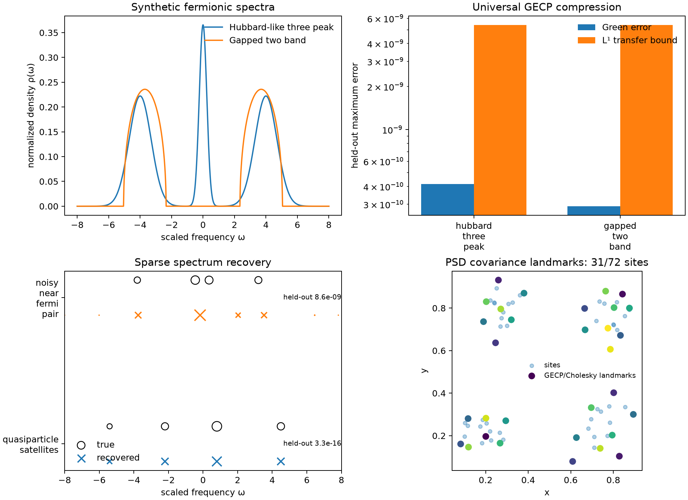
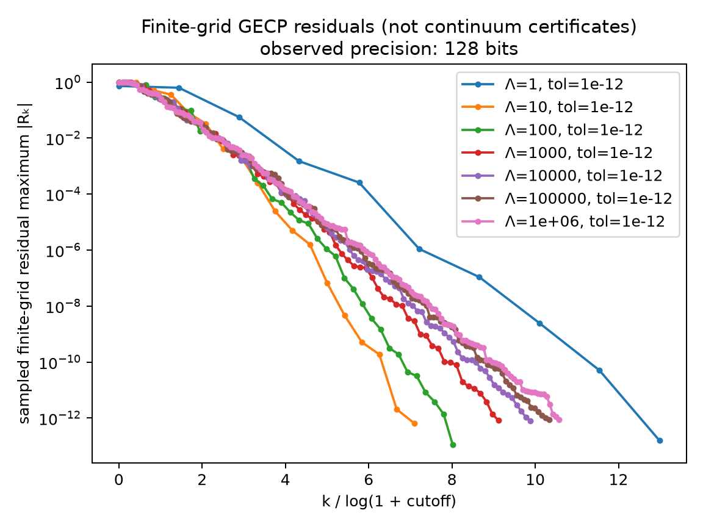
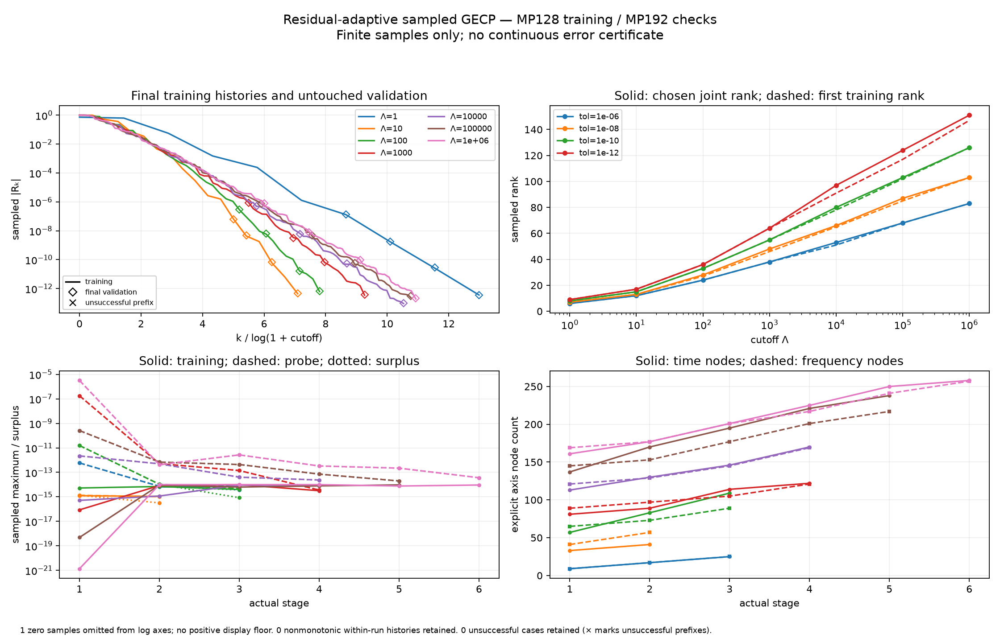

# GECP Kernel Structure

Lean 4 formalization and reproducible Python research package for continuous
Gaussian elimination with complete pivoting (GECP), its positive-definite
pivoted-Cholesky baseline, and the fermionic DLR kernel.

> **Current phase:** DW — numerical coefficient/solve and finite-grid pivot bridge<br>
> **Phase state:** implementation and portable frozen evidence complete; final acceptance in [PR #129](https://github.com/tripp-smith/gecp-kernel-structure/pull/129); full application/release requirements remain open in [PRODUCTIZATION.md](PRODUCTIZATION.md)<br>
> **Last verification:** DW's six-case artifact repeats byte for byte: five completed enclosures and one retained inconclusive solve; independent QR/exact-reproduction checks distinguish useful numerical bounds from large fitting/physical errors. [PR #129](https://github.com/tripp-smith/gecp-kernel-structure/pull/129) is the canonical final-revision acceptance receipt. DV's 1,338-test merged-main and six-platform install closure is in [PR #128](https://github.com/tripp-smith/gecp-kernel-structure/pull/128). Historical research closure remains DQ exact main `e8c35ed`, [CI 40051138962](https://github.com/tripp-smith/gecp-kernel-structure/actions/runs/40051138962)<br>
> **Verification command:** `./scripts/verify.sh`<br>
> **Delivery:** DW [PR #129](https://github.com/tripp-smith/gecp-kernel-structure/pull/129) tracks authorized phase delivery. DV [PR #128](https://github.com/tripp-smith/gecp-kernel-structure/pull/128) is merged at `f40fe39`; its canonical receipt records post-merge checks. DU [PR #127](https://github.com/tripp-smith/gecp-kernel-structure/pull/127), DT [PR #126](https://github.com/tripp-smith/gecp-kernel-structure/pull/126), DS [PR #125](https://github.com/tripp-smith/gecp-kernel-structure/pull/125), and DQ [PR #123](https://github.com/tripp-smith/gecp-kernel-structure/pull/123) are merged. Publication is authorized; upload awaits the verified release artifacts and workflow<br>
> **Claim level:** Required original-SPEC scope complete (estimated 100% at handoff), based on the explicit-item [source audit](FINAL_AUDIT.md) and actual delivery gates, not inventory counts. Exact-GECP rate and staged continuous SPD baseline proved; literal small-cutoff wording has a proved obstruction. Adaptive and sparse evidence remains sampled. DQ repairs conditional pivot-certificate rounding and dyadic-parameter boundaries. No arbitrary-inexact-pivot rate, continuous census certificate, sparse optimality or literature-priority claim<br>
> **Implementation provenance:** [canonical model/mode, terminal goal accounting and billing limitations](FINAL_HANDOFF.md#implementation-run-metadata): completed original goal, 24,738,403 cumulative aggregate tokens and 116,095 goal-accounting seconds (32:14:55), excluding this post-completion documentation task<br>
> **Workflow:** [`$phase-cadence`](.agents/skills/phase-cadence/SKILL.md)

## Status

The new [physical basis API](APPLICATION.md#reusable-physical-green-functions)
supports cached factorizations, complex matrix batches, physical Matsubara
evaluation and safe numerical archives. Run
`uv run python -m examples.reusable_basis` for an analytic fixture with
independent time/frequency checks. This is application-development progress,
not completion of the [full product/release goal](PRODUCTIZATION.md).

The [matched DLR/IR cohort](APPLICATION.md#recorded-dv-matched-cohort-b)
adds independently checked time/frequency errors and a genuine small physical
self-consistency loop using the same protocol with GECP, pydlr and sparse-ir.
The failed sampling/calibration cases are retained. A tested standalone recipe
supports the [upstream proposal](UPSTREAM_PROPOSAL.md), which is not yet external
adoption. The [finite-query numerical bridge](APPLICATION.md#finite-query-numerical-certificates)
now computes actual coefficient/solve/output budgets and finite-grid pivot
quality. It preserves inconclusive and large-error cases. Continuous inexact-run
rates, production Rust integration and final release preparation remain open.

Phase states below describe their historical frozen contracts, not completion
of every original SPEC requirement. The full-scope [audit](COMPLETION_AUDIT.md)
records scope and evidence; [FINAL_AUDIT.md](FINAL_AUDIT.md) records the
original-source closure decision.

| Phase | SPEC milestone | State | Named outputs | Verification evidence | Delivery |
| --- | --- | --- | --- | --- | --- |
| 0 | Bootstrap | complete | two skills, pinned toolchains, CI, package roots | skill validation; focused builds | merged PR #1 |
| A | Exact GECP core | complete | interpolation; run-selected core determinant/nonsingularity | Lean build; axiom audit; exact two-pivot check | merged PR #4 |
| B | PSD baseline | complete | same-domain Schur PSD; diagonal domination; canonical recursive GECP/Cholesky traces; fill bound | Lean axiom audit; tie regression | merged PR #5 |
| C | Fermionic structure/census | complete | exact derivatives/bounds; 128-bit GECP; interval-certified adaptive pivots; endpoint-resolved 21-case census | axiom audit; 27 Python tests; byte-identical census repeat | merged PR #6 |
| D | Separated approximation | complete | `expFamily_separatedApprox`; `fermionicKernel_separatedApprox`; verified dyadic evaluator | axiom audit; 29 tests; full verification | merged PR #7 |
| E | Structural GECP | complete | minimized sign-regular obstruction; `CrossRatioControl`; conditional geometric rate | axiom audit; 30 tests; full verification | merged PR #8 |
| F | Sparse-\(\rho\) application | complete | `greenError_le_kernelError_mul_l1`; OMP/refinement | Lean build; two-atom regression | merged PR #1 |
| R | Release readiness | complete | v1.0.0 handoff; wheel and sdist | full verification; endpoint smoke | merged PR #9; closure PR #10 |
| S | Post-v1 synthetic applications | complete | realistic spectral compression, noisy sparse recovery, PSD landmarks | 35 tests; byte-identical JSON; reviewed plot | implementation `6404311`; direct `main` delivery |
| G | Fermionic GECP rate | complete | exact first two pivots for every cutoff; one-step obstruction; proved two-step half contraction for `0 < Λ ≤ 1`; dyadic block condition | Lean axiom audit; exact/high-precision checks; 45-test full verification; green CI | merged PR #11 |
| H | Verification integrity refresh | complete | interpreter-bound pytest entry point; `urllib3` 2.8.0 development lock | root command passed in maintained and fresh environments; 45 tests; clean dependency audit; green CI | merged PR #12 |
| I | Determinantal sign-coherence bridge | complete | bordered selected core; residual determinant identity; four-minor sign criterion | Lean build; axiom audit; exact identity and first-witness regressions; 47-test full verification; green CI | merged PR #13 |
| J | Strict-sign-regularity transfer | complete | ordered-minor predicate; orientation-aware GECP coherence transfer; positive column scaling; exponential and fermionic orders one and two | Lean build; axiom audit; exact permutation regression; 48-test full verification; green CI | merged PR #14 |
| K | Exponential total-positivity scaffolding | complete | row scaling; positive ordered Vandermonde determinant; positive principal exponential-series determinant term | Lean build; axiom audit; exact factorization regression; 49-test full verification; green CI | merged PR #15 |
| L | Generalized Vandermonde positivity | complete | sparse-polynomial positive-root bound; nonsingularity; homotopy sign transfer | Lean build; axiom audit; exact determinant regression; 50-test full verification; green CI | merged PR #16 |
| M | Generalized Vandermonde boundary | complete | nonnegative-node determinant boundary by positive shifts and continuity | Lean build; axiom audit; exact boundary regression; 51-test full verification; green CI | merged PR #17 |
| N | Finite exponential Cauchy--Binet | complete | `Matrix.det_mul_rect`; `expTaylorMatrix_det_pos` | Lean build; axiom audit; exact rational regression; 52-test full verification; green CI | merged PR #18 |
| O | Exponential determinant limit | complete | `expTaylorMatrix_det_ge_principal`; `expMatrix_det_pos` | Lean build; axiom audit; 100-digit lower-bound regression; 53-test full verification; green CI | merged PR #19 |
| P | All-orders exponential sign regularity | complete | `expKernel_strictSignRegular`; `fermionicKernel_strictSignRegular`; unconditional selected-cross coherence | Lean build; axiom audit; 100-digit sign regression; 54-test full verification; green CI | merged PR #20 |
| Q | Complete-run nonexpansiveness | complete | `Run.append`; `GECP.CompletePivotOn`; `strictSignRegular_gecp_error_nonincreasing`; `fermionicKernel_gecp_error_le_cutoffCorner` | Lean build; axiom audit; exact rational composition check; 54-test full verification; green CI | merged PR #21 |
| T | Geometric-mean determinant reduction | complete | `Run.RealizesPivotPrefix`; pivot-magnitude antitonicity; absolute determinant/pivot product; determinant-power residual bound | Lean build; axiom audit; exact rational check; 54-test full verification; green CI | merged PR #22 |
| U | Low-rank perturbation determinant bound | complete | column-choice expansion; factor-rank vanishing; `abs_det_le_of_factors_approx`; fermionic sampled-core determinant decay | Lean build; public axiom audit; exact rational sizes 2–5; Lean rank-one check; 55-test root verification; green CI | merged PR #23 |
| V | GECP/determinant composition | complete | selected-coordinate domain bridge; exact/coarse residual-power bounds; explicit odd-block rate; quadratic half contraction | Lean build; public axiom audit; exact arithmetic regression; 56-test root verification; green CI | merged PR #24 |
| W | Logarithmic-scale contraction block | complete | `oddBlock_scale_logarithmic`; `fermionicKernel_gecp_error_le_half_logarithmicBlock`; explicit `O((s+1) log(s+1))` half-contraction block | Lean build; public axiom audit; exact dyadic-boundary regression; 57-test root verification; green CI | merged PR #25 |
| X | Arbitrary dyadic accuracy | complete | `oddBlock_factor_le_accuracy`; `oddBlock_scale_accuracy`; `fermionicKernel_gecp_error_le_dyadicAccuracyBlock`; `O((s+1)(log(s+1)+q))` rank theorem | Lean build; public axiom audit; exact scale/accuracy regression; 58-test root verification; green CI | merged PR #26 |
| Y | Determinant-prefactor obstruction | complete | `sylvesterHadamard_det_square`; `entrywise_determinant_constant_base_obstruction`; exact obstruction to a dimension-free generic determinant base | Lean build; public axiom audit; exact arithmetic regression; 59-test root verification; green CI | merged PR #27 |
| Z | Multiplicative-Monge corner localization | complete | `fermionicKernel_residualUpdate_factor`; `fermionicKernel_residualUpdate_le_crossArea`; `fermionicKernel_residualUpdate_le_half_of_crossArea` | Lean build; public axiom audit; 100-decimal regression; 60-test root verification; green CI | merged PR #28 |
| AA | Two-corner power-secant residual | complete | `fermionicKernel_twoCornerResidual_eq_powerSecantError`; nonnegative residual bounded by both corner cross areas | Lean build; public axiom audit; 100-decimal asymmetric/reflected regression; 61-test root verification; green CI | merged PR #29 |
| AB | Two-corner half-contraction obstruction | complete | `fermionicKernel_twoCornerResidual_not_half_contraction`; exact rational-coordinate witness and positive excess | Lean build; public axiom audit; exact rational sweep; direct 100-decimal nested update; 62-test root verification; green CI | merged PR #30 |
| AC | Third-pivot frequency localization | complete | `fermionicKernel_thirdCompletePivot_frequency_lt_halfCutoff`; quarter bound on both outer halves; exact center witness | Lean build; public axiom audit; 100-decimal cutoff/grid regression; 63-test root verification; green CI | merged PR #31 |
| AD | Persistent outer-half exclusion | complete | `fermionicKernel_outerHalfBound_preserved`; mixed strip/global update invariant; later-pivot localization above one quarter | Lean build; public axiom audit; exact sign-orientation checks; 80-decimal five-update regression; 64-test root verification; green CI | merged PR #32 |
| AE | Exceptional-column determinant restart | complete | `Matrix.abs_det_le_two_pow_mul_of_factors_approx_except`; fermionic smaller-band determinant decay with exact exceptional columns | Lean build; public axiom audit; exact zero/two-exception rank-shift regression; 65-test root verification; green CI | merged PR #33 |
| AF | GECP exceptional-column composition | complete | `fermionicKernel_gecp_error_pow_le_two_pow_except`; selected-core decay at an independent smaller approximation scale | Lean build; public axiom audit; exact exceptional selected-core/pivot-product regression; 66-test root verification; green CI | merged PR #34 |
| AG | Two-corner exceptional indices | complete | `symmetricTwoCornerRun`; exact two-index exception set; smaller-band continuation determinant decay | Lean build; public axiom audit; exact prescribed-corner/central-continuation regression; 67-test root verification; green CI | merged PR #35 |
| AH | Finite central-prefix runs | complete | `Run.ofResidualSequenceFrom`; exact final residual/pivots/cardinality; above-quarter central completeness and determinant composition | Lean build; public axiom audit; exact three-step recurrence reconstruction; 68-test root verification; green CI | merged PR #36 |
| AI | Above-quarter stopping bound | complete | strict pivot-product determinant lower bound; exponent-budget contradiction; global quarter residual before `2048(s+1)^2` steps | Lean build; public axiom audit; exact scale/transition arithmetic; 69-test root verification; green CI | merged PR #37 |
| AJ | Multi-bordered residual minors | complete | arbitrary-border determinant factorization; orientation-aware all-orders sign transfer; fermionic residual-minor nonsingularity | Lean build; public axiom audit; exact rational border sizes 0--3; 70-test root verification; green CI | merged PR #38 |
| AK | Balanced-sign residual gauges | complete | anchor-based sign normalization; fresh-coordinate positivity; magnitude preservation; exact minor scaling | Lean build; public axiom audit; exact all-anchor rational regression; 71-test root verification; green CI | merged PR #39 |
| AL | Compound residual gauges | complete | fresh tuple types; compound-minor cross-product coherence; positive magnitude-preserving compound gauges | Lean build; public axiom audit; exact rational compound orders 1--3; 72-test root verification; green CI | merged PR #40 |
| AM | Two-border condensation inequality | complete | exact selected-core Desnanot--Jacobi identity; same-sign factor-one max bound; fermionic specialization | Lean build; public axiom audit; exhaustive exact 256-case two-border regression; 73-test root verification; green CI | merged PR #41 |
| AN | Factorial-free continuation determinants | complete | recursive sign coherence; continuation pivot envelope; exact `B^m` selected-core determinant bound; fermionic specialization | Lean build; public axiom audit; exact all-suffix determinant regression and 1-dominance obstruction; 75-test root verification; green CI | merged PR #42 |
| AO | Masked dyadic remainder obstruction | complete | `dyadicTaylorError_not_strictSignRegularAtOrder_two`; exact first-transition positive-minor witness | Lean build; public axiom audit; 100-digit implementation check and 36-point transition sweep; 76-test root verification; green CI | merged PR #43 |
| AP | Unmasked Taylor-tail beta structure | complete | `eighthOrderTail_eq_betaMoment`; strict positivity; exact order-two beta-moment sign reduction | Lean build; public axiom audit; 100-digit triple evaluation and 315-minor sweep; 77-test root verification; green CI | merged PR #44 |
| AQ | Tilted-beta moment gap | complete | `eighthOrderBetaMoment_two_mul_two_lt_one`; `eighthOrderBetaMoment_variance_numerator_lt` | Lean build; public axiom audit; exact `Fraction` check; 100-digit dense sweep; 78-test root verification; green CI | merged PR #45 |
| AR | Beta-moment logarithmic elasticity | complete | moment derivatives; `eighthOrderBetaElasticity_hasDerivAt`; `eighthOrderBetaElasticity_strictAntiOn` | Lean build; public axiom audit; 100-digit derivative/monotonicity sweep; 79-test root verification; green CI | merged PR #46 |
| AS | Local beta-moment order-two sign | complete | scale-ratio monotonicity; `eighthOrderBetaMoment_fin_two_det_neg`; `eighthOrderTail_fin_two_det_neg` | Lean build; public axiom audit; 100-digit ratio/minor sweep; 80-test root verification; green CI | merged PR #47 |
| AT | Truncated-power composition bridge | complete | scaled beta identity; common-cutoff exponential/truncated-power composition | Lean build; public axiom audit; 100-digit identity checks; order 2--5 minor sweep; 81-test root verification; green CI | merged PR #48 |
| AU | Finite composition strictness | complete | `signature_mul_det_mul_rect_nonneg`; selected-summand lower bound; `signature_mul_det_mul_rect_pos` | Lean build; public axiom audit; exact rational composition regression; 82-test root verification; green CI | merged PR #49 |
| AV | Truncated-power total-nonnegativity base | complete | `TotallyNonnegativeAtOrder`; orders one and two; exact Schoenberg--Whitney support criterion | Lean build; public axiom audit; exact 784-case support regression; 83-test root verification; green CI | merged PR #50 |
| AW | Normalized truncated-power convolution ladder | complete | `normalizedTruncatedPowerKernel`; degree-seven bridge; natural and shared-domain successor recurrences | Lean build; public axiom audit; exact rational degrees 0--7; 84-test root verification; green CI | merged PR #51 |
| AX | All-orders order-kernel total nonnegativity | complete | exact `0`/`1` minor classification; `TotallyNonnegative` degree-zero base | Lean build; public axiom audit; 3,381 exact staircase minors through order five; 85-test root verification; green CI | merged PR #52 |
| AY | Determinant/interval-integral commutation | complete | `detUpdateRowCLM`; exact commutation; nonnegative and strict transfer | Lean build; public axiom audit; exact affine-row regression; 86-test root verification; green CI | merged PR #53 |
| AZ | Ordered multi-row determinant integration | complete | weak-order minor closure; finite row-integration iteration; ordered-interval TN transfer | Lean build; public axiom audit; exact staircase-integral regression; 87-test root verification; green CI | merged PR #54 |
| BA | All-orders truncated-power total nonnegativity | complete | adjacent-row determinant invariance; common-upper TN transfer; degree-successor closure; all-orders degree-seven factor | Lean build; public axiom audit; 7,088 exact minors across degrees 0--7 and orders 1--4; 88-test root verification; green CI | merged PR #55 |
| BB | Andréief integrand symmetrization | complete | exact permutation-sum/product-of-determinants identity; all-orders ordered-sample weak sign | Lean build; public axiom audit; exact rational `3 x 3` permutation regression; 89-test root verification; green CI | merged PR #56 |
| BC | Product-measure Andréief identity | complete | coordinate-permutation invariance; integrated factorial symmetrization; determinant of pair integrals; division-free finite-order Andréief theorem | Lean build; public axiom audit; exact three-monomial unit-cube regression; 90-test root verification; green CI | merged PR #57 |
| BD | Arbitrary-sample and Taylor-tail weak signs | complete | common-permutation sign cancellation; sorting/repeated-sample dichotomy; weak-sign integral-composition closure; all-orders Taylor-tail weak signs | Lean build; public axiom audit; exact six-permutation/repeated-sample regression; 91-test root verification; green CI | merged PR #58 |
| BE | Strict all-orders Taylor-tail signs | complete | explicit interlacing support sample; positive truncated-power determinant at every order; compact-support positive-measure localization; strict Andréief and Taylor-tail signs | Lean build; public axiom audit; exact interlacing staircase through order 12; 92-test root verification; green CI | merged PR #59 |
| BF | Factorial-free Taylor-tail GECP envelope | complete | positive-quadrant strict-sign-regular tail kernel; exact rank-eight decomposition; unit-band `(1/8!)^n` complete-run determinant bound | Lean build; public axiom audit; 120-digit eight-step complete-pivot regression; 93-test root verification; green CI | merged PR #60 |
| BG | Positive-series compatible fermionic split | complete | equivalent `u=1-t` positive-exponential representation; eight positive monomial features; strictly totally positive tail; `(1/8!)^n` tail-GECP envelope | Lean build; public axiom audit; 140-digit mixed-coefficient sweep through order six; 94-test root verification; green CI | merged PR #61 |
| BH | Block-feature coefficientwise Cauchy--Binet | complete | `highFeatureCount`; `signature_mul_det_weightedFeatureProduct_eq_sum`; `expTaylor_blockFeatureCoefficient_nonneg` | Lean build; public axiom audit; exact rational coefficient regression; 95-test root verification; green CI | merged PR #62 |
| BI | Mixed-column coefficient bridge | complete | `mixedColumnPolynomial`; `blockFeatureCoefficient_eq_mixedColumnCoefficient`; `expTaylor_mixedColumnCoefficient_nonneg` | Lean build; public axiom audit; exact rational coefficient identity; 95-test root verification; green CI | merged PR #63 |
| BJ | Infinite-tail mixed coefficients | complete | `mixedColumnCoefficient_tendsto`; exact eighth-order tail matrix; `positiveEighthOrderTail_mixedColumnCoefficient_nonneg` | Lean build; public axiom audit; 120-digit truncation convergence; 96-test root verification; green CI | merged PR #64 |
| BK | Low-rank tail amplification | complete | `mixedColumnCoefficient_eq_zero_of_rank`; `mixedColumnPolynomial_rank_amplification`; positive-series fermionic specialization | Lean build; public axiom audit; 350-digit orders 9--16 sweep; 97-test root verification; green CI | merged PR #65 |
| BL | Amplified-kernel envelope | complete | `mixedColumnPolynomial_det_mono`; amplified-kernel strict total positivity; unit-band bound `2`; complete-run bound `2^n` | Lean build; public axiom audit; 250-digit orders 1--8 regression; 98-test root verification; green CI | merged PR #66 |
| BM | Total-positive Hadamard envelope | complete | `StrictlyTotallyPositive`; northwest-Schur preservation; arbitrary-sample amplified-minor `2^n` bound; original determinant decay | Lean build; public axiom audit; 12,869 exact ordered minors and Schur stages; 99-test root verification; green CI | merged PR #67 |
| BN | Positive-series GECP composition | complete | permutation-invariant determinant envelope; residual-power composition; ten-pivot half contraction | Lean build; public axiom audit; 180-digit grids of sizes 16, 24, and 32; 100-test root verification; green CI | merged PR #68 |
| BO | Signed unit-band amplification | complete | affine frequency shift; `2^n / 128^(n-8)` arbitrary-sample determinant envelope; twelve-pivot full signed-band half contraction | Lean build; public axiom audit; 180-digit grids of sizes 16, 24, and 32; 101-test root verification; green CI | merged PR #69 |
| BP | Translated unit-band amplification | complete | center-parametric affine shift; cutoff-uniform `2^n / 128^(n-8)` determinant envelope; twelve-pivot contraction on every width-two band | Lean build; public axiom audit; 180-digit centers `-8`, `-2`, `3`, and `9`; 102-test root verification; green CI | merged PR #70 |
| BQ | Residual amplification bridge | complete | exact obstruction to one-sided frozen-column amplification; prefix-independent Schur-residual rank amplification and augmented-core composition | Lean build; public axiom audit; exact rational LU certificate and residual-split regression; 103-test root verification; green CI | merged PR #71 |
| BR | Schur-aware feature elimination | complete | canonical linear row-conditioning operator; exact preservation of a right-feature low-rank factor through arbitrary GECP prefixes; BQ-ready residual split | Lean build; public axiom audit; exact three-pivot feature-transport and rank regression; 104-test root verification; green CI | merged PR #72 |
| BS | Finite-weight conditioned-pencil amplification | complete | degree-eight norming set for rank-eight determinant pencils; sign-free amplification from nine fixed weights; order-18 half-power reduction | Lean build; public axiom audit; exact interpolation, obstruction, and norming regression; 105-test root verification; green CI | merged PR #73 |
| BT | Two-sided companion projection | complete | linear two-sided fixed-pivot projection; selected-row/column annihilation; exact transport of both feature factors; matched-minor Cauchy--Binet interface | 3,568-job Lean build; public axiom audit; 2,760 exact sign-coherence samples; 106-test root verification; green CI | merged PR #74 |
| BU | Companion Plücker factorization | complete | left/right feature-augmented cores; selected-core determinant factorization; exact matched-minor product and sign equivalence | 3,570-job Lean build; public axiom audit; 2,382 exact bordered-minor identities; 106-test root verification; green CI | merged PR #75 |
| BV | Graded Plücker pairing | complete | exact termwise-sign obstruction; fixed-coordinate block-feature factorization; graded bordered-minor coefficient identity | 3,571-job Lean build; public axiom audit; exact 2-of-56 sign obstruction and graded-sum identity; 107-test root verification; green CI | merged PR #76 |
| BW | Bordered-pencil linearization | complete | rank-update block determinant; graded feature-pencil bridge; exact finite-weight linearization and sign-cycle obstruction | 3,572-job Lean build; public axiom audit; 10 exact rational weights; 107-test root verification; green CI | merged PR #77 |
| BX | Double-bordered companion determinant | complete | generic two-sided companion Schur formula; squared-core determinant factorization; exact multi-pivot companion checks and minor-sign obstruction | 3,573-job Lean build; public axiom audit; 10 exact rational weights; 107-test root verification; green CI | merged PR #78 |
| BY | Selected-core companion closed form | complete | closed row/column conditioning formulas; commuting projectors; arbitrary-run four-term formula; sampled double-border determinant specialization | 3,574-job Lean build; public axiom audit; 144 exact deterministic randomized closed-form checks; 107-test root verification; green CI | merged PR #79 |
| BZ | Upper-tangent companion lift | complete | layered-kernel minor representation; feature-space tangent factorization; normalized-envelope-to-half-power theorem; cross-inversion-oriented coefficient evidence | 3,577-job Lean build; public axiom audit; 24 exact tangent factorizations; 360 exact oriented coefficient polynomials; 108-test root verification; green CI | merged PR #80 |
| CA | Shuffle-aware tangent Cauchy--Binet | complete | ordered three-factor expansion; modular factor-orientation criterion; upper-tangent sample specialization | 3,579-job Lean build; public axiom audit; 24 exact shuffled triple expansions; 108-test root verification; green CI | merged PR #81 |
| CB | Interleaved tangent cells | complete | layer/feature reindexing; local tangent-cell TN; unit full determinant; conditional middle shuffle-orientation transfer | 3,580-job Lean build; public axiom audit; 397,252 exact middle-minor checks; 109-test root verification; green CI | merged PR #82 |
| CC | Upper-bidiagonal total nonnegativity | complete | noncrossing-support TN criterion; all-orders interleaved-middle TN; unconditional diagonal middle shuffle certificate | 3,581-job Lean build; public axiom audit; 12,403 exact nonidentity matching terms; 110-test root verification; green CI | merged PR #83 |
| CD | Factorwise orientation obstruction | complete | exact negative double-flag term; impossibility of separate factor orientations; positive complete tangent determinant | 3,582-job Lean build; public axiom audit; exact 2/3-feature census; 111-test root verification; green CI | merged PR #84 |
| CE | Conditioned tangent cancellation collapse | complete | factorized distinguished-minor identity; global double-flag regrouping; finite positive-Taylor diagonal specialization | 3,584-job Lean build; public axiom audit; 5,000 exact nonnegative-weight cases; 112-test root verification; green CI | merged PR #85 |
| CF | Sparse diagonal obstruction | complete | sparse feature projection; isolated matched-coordinate determinant; physical step-weight narrowing | 3,585-job Lean build; public axiom audit; 2 exact sparse failures and 90 positive step weights; 112-test root verification; green CI | merged PR #86 |
| CG | Grouped conditioned Plucker bridge | complete | grouped tail-count coefficient identity; contiguous step-weight bordered sum; grouped-sign implication | 3,586-job Lean build; public axiom audit; exact all-cutoff grouping and 90 step evaluations; 112-test root verification; green CI | merged PR #87 |
| CH | Minimal grouped cancellation witness | complete | exact three-feature negative coordinate; positive proper prefix/suffix groups; two all-weight step inequalities | 3,587-job Lean build; public axiom audit; exact 6,468-case two-feature and 800-witness three-feature census; 113-test root verification; green CI | merged PR #88 |
| CI | Three-feature grouped sign theorem | complete | three coordinate and two adjacent-group factorizations; arbitrary ordered-node positivity; all-weight step consequences | 3,588-job Lean build; public axiom audit; 2,198 exact boundary/interior rational cases; 114-test root verification; green CI | merged PR #89 |
| CJ | Weighted centered-group association | complete | weighted Chebyshev numerator; two-block conditional-mean decomposition; arbitrary-feature one-pivot grouped and step signs | 3,592-job Lean build; public axiom audit; 4,644 exact weighted groups and 6,782 Taylor groups; 115-test root verification; green CI | merged PR #90 |
| CK | Compound generalized-spectrum reduction | complete | common-factor determinant-pencil factorization; nonnegative generalized-spectrum certificate; exact subset-lattice obstruction and low-order spectral audit | 3,593-job Lean build; public axiom audit; 1,481 exact oriented polynomials; 116-test root verification; green CI | merged PR #91 |
| CL | Fresh-order-two Lorentzian bridge | complete | exact 2x2 pencil coefficients and discriminant; constructive nonnegative-root factorization; cross-minor obstruction audit | 3,594-job Lean build; public axiom audit; 3,868 exact pencils; 117-test root verification; green CI | merged PR #92 |
| CM | Two-block Lorentzian covariance | complete | division-free cross-increment decomposition; ordered-block nonnegativity; reverse covariance inequality; geometric ratio-coordinate specialization | 3,594-job Lean build; public axiom audit; 1,764 exact weighted splits and 11,024 conditioned coordinate products; 117-test root verification; green CI | merged PR #93 |
| CN | Projective rank-two ratio bridge | complete | ratio-factorized matched-minor identities; exact block-matrix coefficient bridge; matrix-pencil Lorentzian theorem; cyclic-prefix obstruction audit | 3,595-job Lean build; public axiom audit; 500 exact conditioned cases and 2,868 cutoff intervals; 117-test root verification; green CI | merged PR #94 |
| CO | Projective chart invariance | complete | two-sided basis-change coefficient scaling; discriminant invariance; chart-transfer certificate | 3,595-job Lean build; public axiom audit; 512 exact invertible and one singular chart changes; 118-test root verification; green CI | merged PR #95 |
| CP | Separating projective pole chart | complete | explicit pole basis; transformed block identity; reciprocal pole-to-Lorentzian certificate | 3,595-job Lean build; public axiom audit; 3 exterior/interior charts, all 5 cutoffs, and one rejected collision; 119-test root verification; green CI | merged PR #96 |
| CQ | Matched-minor separator reduction | complete | oriented/scaled pole bases; projective matched-coordinate invariance; positive-chart comonotonicity; separator theorem | 3,595-job Lean build; public axiom audit; exact separators for all 2,868 cutoffs; 119-test root verification; green CI | merged PR #97 |
| CR | Conditioned rank-two Plucker bridge | complete | selected-core-square matched-coordinate identity; oriented sign equivalence | 3,596-job Lean build; public axiom audit; 11,024 exact arbitrary-pivot augmented-core identities; 119-test root verification; green CI | merged PR #98 |
| CS | Common chirotope schedule | complete | common-schedule cancellation; conditioned oriented-sign composition; fixed-schedule obstruction | 3,596-job Lean build; public axiom audit; 11,024 exact aligned schedules; 119-test root verification; green CI | merged PR #99 |
| CT | Homotopy sign lock | complete | nonvanishing continuous-path endpoint sign theorem; determinant specialization | 3,597-job Lean build; public axiom audit; 11,024 exact canonical midpoint checks; 119-test root verification; green CI | merged PR #100 |
| CU | Ordered-chamber obstruction | complete | exact exponential-cubic sign-changing chamber witness; forced-zero path | 3,598-job Lean build; public axiom audit; exact rational determinant reconstruction; 120-test root verification; green CI | merged PR #101 |
| CV | Complete-pivot chirotope obstruction | complete | exact rational exponential kernel; two certified complete pivots; opposite crossed augmented signs | 3,600-job Lean build; public axiom audit; exact kernel, residual, pivot, and determinant reconstruction; 121-test root verification; green CI | merged PR #102 |
| CW | Aggregate mean-shift Lorentzian bridge | complete | covariance-plus-mean-shift discriminant criterion; Phase CV aggregate survival | 3,600-job Lean build; public axiom audit; 42 exact witness pencils and 16,424 extended conditioned pencils; 122-test root verification; green CI | merged PR #103 |
| CX | Prefix-cone Hodge obstruction | complete | exact complete-pivot exponential witness; two-dimensional positive plane; all contiguous prefix planes Lorentzian | 3,601-job Lean build; public axiom audit; exact rational reconstruction; 123-test root verification; green CI | merged PR #104 |
| CY | Adjacent-cutoff discriminant bridge | complete | cutoff-transfer identity; shared canonical node; projected-cross factorization and matrix discriminant theorem | 3,602-job Lean build; public axiom audit; 13,924 exact transfer identities and 9,170 interior signs; 123-test root verification; green CI | merged PR #105 |
| CZ | Interior transfer-node obstruction | complete | four-node finite-Taylor obstruction; alternate neighboring certificates; reproducible all-fresh-pair audit | 3,603-job Lean build; public axiom audit; 54,845 exact transfers and 47,496 covered cutoffs; 80/160-digit exponential regression; 126-test root verification; green CI | merged PR #106 |
| DA | One-pivot exponential Chebyshev sign | complete | `expMonomialMinor_signed_pos`; independent-triple matched-product positivity; coherent depth-ten localization counterexample | 3,605-job Lean build; public axiom audit; 324 sign checks at 80/160 digits; 66 matched products; 129-test root verification; green CI | merged PR #107 |
| DB | Adaptive transfer coverage obstruction | complete | seven-pivot coherent 13-term witness; `phaseDB_not_adaptive_coverage`; surviving strict discriminant; reproducible integer certificate | 3,608-job Lean build; accepted axioms; 133-test root verification; 160/320-digit exponential evidence; green CI | merged PR #108 |
| DC | All-orders local-minor contraction bridge | complete | singleton Fischer inequality; arbitrary-pivot matched-rank bound; actual fermionic specialization; original companion target open | 3,610-job Lean build; accepted axioms; 2,520 exact one-step checks; 1,376 prefix/gauge checks; 140-test root verification; green CI | merged [PR #109](https://github.com/tripp-smith/gecp-kernel-structure/pull/109) |
| DD | Common all-orders residual sign gauge | complete | `Run.gaugedFinalResidual_strictSignRegular`; absolute-minor preservation; arbitrary-prefix actual Schur bound; original-run frequency transport | 3,614-job Lean build; accepted axioms; 146 tests; 3,825 exact gauge checks; 350 exact next-step checks; 160/320-digit evidence; green CI | merged [PR #110](https://github.com/tripp-smith/gecp-kernel-structure/pull/110) |
| DE | Cutoff-uniform local panel determinant budget | complete | rank-`8p` panel approximation; `fermionicKernel_panel_minor_det_le_dyadicBudget` at order `16(33+4q)`; both signs and central panels | 3,615-job Lean build; accepted axioms; 151 tests; exact feature/exponent checks; independent precision evidence; green CI | merged [PR #111](https://github.com/tripp-smith/gecp-kernel-structure/pull/111) |
| DF | Backward witnesses and global panel-pivot rate | complete | `markedPivotProduct_le_initialMinor`; fixed-order panel pivot count; `fermionicKernel_gecp_error_le_localPanelBlock`; every-later-rank corollary | 3,619 Lean jobs; accepted axioms; 155 tests; exact/high-precision evidence; green CI | merged [PR #112](https://github.com/tripp-smith/gecp-kernel-structure/pull/112) |
| DG | Real-cutoff logarithmic rate and parameter audit | complete | actual-domain block rate; `fermionicKernel_gecp_error_le_logarithmic`; all-cutoff/tolerance corollaries; `fermionicKernel_smallCutoff_logarithmic_obstruction` | 3,622 Lean jobs; accepted axioms; 159 tests; exact/high-precision evidence; green CI | merged [PR #113](https://github.com/tripp-smith/gecp-kernel-structure/pull/113) |
| DH | Finite-run and physical-error closure | complete | finite-prefix witnesses; `fermionicKernel_finiteRun_error_le_exp`; exact stop / tolerance; selected-core cross identity; actual Green-error bound | 3,625 Lean jobs; accepted axioms; 163 tests; exact / independent-precision evidence; green CI | merged [PR #114](https://github.com/tripp-smith/gecp-kernel-structure/pull/114) |
| DI | Original-SPEC completion audit | complete | 40-group audit; real D1; compact maxima; exact grid certificates; enforced axiom gate; clean packaging | 3,627 Lean jobs; 838 audited declarations; 177 tests; isolated wheel smoke; green CI | merged [PR #115](https://github.com/tripp-smith/gecp-kernel-structure/pull/115) |
| DJ | Original-kernel fill-distance control | complete | arbitrary-domain PSD residual/order; energy comparison; `2*L*h` fill bound; compact diagonal complete maxima | 3,630 Lean jobs; 857 audited declarations; 180 tests; green CI | merged [PR #116](https://github.com/tripp-smith/gecp-kernel-structure/pull/116) |
| DK | Strict-SPD complete-pivot reduction | complete | fresh strict Schur congruence; every complete pivot diagonal; actual-run Cholesky equivalence; compact/fill corollaries | 3,633 Lean jobs; 876 audited declarations; 183 tests; green CI | merged [PR #117](https://github.com/tripp-smith/gecp-kernel-structure/pull/117) |
| DL | Complete numerical result metadata | complete | precision/conditioning/tie/certification scopes; returned-error convergence; optimizer failure/rejection; schema-2 summaries | 3,633 Lean jobs; 876 audited declarations; 232 tests; isolated wheel smoke; green CI | merged [PR #118](https://github.com/tripp-smith/gecp-kernel-structure/pull/118) |
| DM | Complete census diagnostics and normalized curves | complete | 28 schema-2 records through `1e-12`; full prefix/core/geometry metadata; normalized residual plot | full primary byte repeat; 192-bit checks of 30 cores; three order-32 GECP runs; 3,633 Lean jobs; 876 audited declarations; 430 tests; green push/PR CI | merged [PR #119](https://github.com/tripp-smith/gecp-kernel-structure/pull/119) |
| DN | Fair six-method spectral comparisons (R31) | complete | 192 shared-observation GECP/AAA/vector-fitting/Prony/NLS/OMP fits; rational/exponential bridges; retained failures | byte-repeated JSON/PNG; independent reconstruction of every error; 513-test root gate; green push/PR CI; wheel checks including SciPy 1.15 | merged [PR #120](https://github.com/tripp-smith/gecp-kernel-structure/pull/120) |
| DO | Independent original-SPEC completion audit | complete | thirty-section audit; conservative certificates, sampled ties, scaled updates and failure coverage; generic completeness layering | 569-test root, 3,634 Lean jobs, 876 axiom reports; green push/PR CI; installed-wheel checks including SciPy 1.15.0; full goal NOT COMPLETE, R25 absent | merged [PR #121](https://github.com/tripp-smith/gecp-kernel-structure/pull/121) |
| DP | Residual-adaptive seven-cutoff census | complete | explicit nested panels/axes, residual-driven refinement, untouched final validation, repeated data/normalized PNG | 713-test main root, green exact-main CI; 21 independent core/28 cross checks; clean archives and two installed environments | merged [PR #122](https://github.com/tripp-smith/gecp-kernel-structure/pull/122); main closure `5a5fef0` |
| DQ | Original-SPEC closure audit | complete | explicit-item source audit, 22 public theorem consumers, real certificate/parameter boundary repairs | 757-test exact-main root (150.31 seconds), green CI 40051138962, rebuilt clean archives and two installed environments | merged [PR #123](https://github.com/tripp-smith/gecp-kernel-structure/pull/123); main closure `e8c35ed` |
| DR | Final documentation and repository handoff | verified | completed-main evidence, terminal goal accounting, synchronized claim docs, safe rerun commands and link/provenance regressions | 759-test exact-source root, green push/PR CI, clean archives and two installed environments; no proof/algorithm/data changes | merged [PR #124](https://github.com/tripp-smith/gecp-kernel-structure/pull/124) |
| DS | Research-workflow skill hardening | complete | original-SPEC contracts, proof-route checkpoints, conditional numerical/release guidance | skill validation, behavioral forward tests and revision-specific root/CI evidence in PR | merged [PR #125](https://github.com/tripp-smith/gecp-kernel-structure/pull/125) |
| DT | Matched DLR/IR application benchmarks | [receipt](https://github.com/tripp-smith/gecp-kernel-structure/pull/126) | common physical observations, optional adapters, cached fit-plan measurements and retained range failure | 167 focused optional-environment tests; 9-case pilot; independent 100-digit check; full root/CI in receipt | [PR #126](https://github.com/tripp-smith/gecp-kernel-structure/pull/126) |

Allowed states are `planned`, `in progress`, `verified`, `complete`, and
`blocked (research)`. A phase becomes `complete` only after its verified change
is merged, or after a verified direct-to-`main` delivery explicitly requested
by the user.
A table entry may link its canonical PR receipt rather than duplicate changing
verification and delivery state.

## Quick start

Prerequisites are [uv](https://docs.astral.sh/uv/) and the Lean toolchain
manager `elan`.

```bash
uv sync --all-extras
lake exe cache get
./scripts/verify.sh
```

The Python package is named `kernelgecp` and the Lean library is
`GECPKernelStructure`. See [APPLICATION.md](APPLICATION.md) for API usage,
[FINDINGS.md](FINDINGS.md) for claim status, and [RESEARCH.md](RESEARCH.md) for
theorem history. The current handoff and historical v1 delivery record are in
[FINAL_HANDOFF.md](FINAL_HANDOFF.md), including the bounded
[implementation run metadata](FINAL_HANDOFF.md#implementation-run-metadata).

## Python implementation

`kernelgecp` is the executable research layer of the project. It is not a
second, informal source of mathematical truth: Lean owns the proved theorem
statements, while Python independently realizes the algorithms, exercises the
theorem consequences on exact and high-precision examples, searches for
structure, and produces reproducible application evidence. The package is
typed, deterministic for a fixed configuration, and designed to report
failure or budget exhaustion explicitly instead of converting either into a
successful result.

### Architecture and numerical behavior

| Module | Implementation | Role in the project |
| --- | --- | --- |
| [`kernelgecp/types.py`](kernelgecp/types.py) | Validated `GECPConfig` plus typed GECP, Cholesky, pivot-certificate, high-precision, sparse-fit, and census records | Makes convergence, stopping reason, precision, conditioning, ties, and certification part of the result rather than information hidden in logs |
| [`kernelgecp/kernels.py`](kernelgecp/kernels.py) | Vectorized `FermionicKernel` with sign-dependent overflow-safe formulas, strict domain checks, reflection evaluation, and explicit-precision `mpmath` evaluation | Turns the formal reflection and centered identities into a stable evaluator that remains finite at frequencies as large as `±10⁶` |
| [`kernelgecp/grids.py`](kernelgecp/grids.py) | Composite Chebyshev–Lobatto time grids resolving endpoint layers down to `1/Λ`, and dyadic frequency bands refined near zero and the cutoff | Samples the geometry that a uniform grid would miss as the cutoff grows while keeping the grid construction deterministic |
| [`kernelgecp/adaptive_grids.py`](kernelgecp/adaptive_grids.py), [`adaptive_grid.py`](kernelgecp/adaptive_grid.py) | Nested physical panels, residual/surplus marking, mirrored selective refinement, MP selected-cross probes and untouched validation | Supplies genuine all-cutoff residual-adaptive sampled evidence while preserving explicit axes, budgets, failures and coordinate precision |
| [`kernelgecp/gecp.py`](kernelgecp/gecp.py) | Float64 and arbitrary-precision finite-grid GECP, fermionic adaptive GECP, lexicographic near-tie handling, rank-one residual updates, determinant and smallest-singular-value histories, and solve-based cross evaluation | Provides the central experimental algorithm and independently checks interpolation, pivot-product, conditioning, residual, and stopping behavior without forming a numerical inverse |
| [`kernelgecp/cholesky.py`](kernelgecp/cholesky.py) | Canonical diagonal-pivoted Cholesky with symmetry checks, PSD breakdown detection, deterministic ties, factor output, and residual history | Supplies the positive-definite control experiment corresponding to the formal GECP/pivoted-Cholesky equivalence |
| [`kernelgecp/certified.py`](kernelgecp/certified.py) | Priority-queue branch-and-bound using either supplied Lipschitz constants or outward-rounded `mpmath` interval enclosures and optional interval gradients | Separates a sampled large residual from a certified approximate continuous pivot; exhausting `max_cells` returns an uncertified certificate |
| [`kernelgecp/approximation.py`](kernelgecp/approximation.py) | Published rank-count utilities, a high-precision evaluator matching the Lean dyadic truncated-Taylor construction, and a practical piecewise barycentric Chebyshev interpolant | Independently validates the explicit `O(log Λ log(1/ε))` separated construction while keeping the practical interpolant distinct from the theorem |
| [`kernelgecp/surrogates.py`](kernelgecp/surrogates.py) | Exact `Fraction` determinants, exact lexicographic GECP, exhaustive minor-sign enumeration, selected-cross sign-coherence checks with first-failure witnesses, and the fixed geometric-surrogate census | Lets structural hypotheses fail or survive in exact arithmetic before they are promoted to a theorem contract |
| [`kernelgecp/research.py`](kernelgecp/research.py) | Exact-form first- and two-corner residual diagnostics, decimal-preserving cutoff-scaled block analysis, and a focused interval-certified residual trajectory | Independently checks the proved base block and tests the Phase G scaling contract while encoding the boundary between a formal theorem, finite-grid observations, a certified bounded trajectory, and a cutoff-uniform rate |
| [`kernelgecp/census.py`](kernelgecp/census.py) | TOML-driven cutoff/tolerance sweeps, one strict trajectory per cutoff, configuration hashing, Git-revision capture, canonical decimal strings, deterministic ordering, and atomic JSONL replacement | Makes the pivot census repeatable and auditable rather than a collection of one-off notebook outputs |
| [`kernelgecp/sparse.py`](kernelgecp/sparse.py) | Orthogonal matching pursuit over candidate frequencies followed by bounded nonlinear least-squares refinement | Demonstrates the problem-specific sparse-spectral alternative to a universal kernel basis and reports non-convergence honestly |
| [`kernelgecp/applications.py`](kernelgecp/applications.py) | Typed configurations and results for continuous-spectrum compression, clean/noisy sparse recovery, Green-function quadrature, and PSD covariance landmarks | Connects the formal and numerical components in deterministic, application-level workloads with held-out errors and explicit evidence boundaries |

There are three deliberately different execution paths:

1. `gecp_matrix` applies complete pivoting to any finite rectangular matrix.
   At 53 bits it uses NumPy; above 53 bits it retains the elimination,
   determinant, and singular-value calculations in `mpmath` and serializes
   canonical decimal values.

2. `gecp(..., config=GECPConfig(pivot="grid"))` evaluates any supplied kernel
   on explicit grids, or uses the canonical endpoint-resolved grids for
   `FermionicKernel`. It is the scalable and exactly repeatable path used by
   the committed census.

3. `gecp(FermionicKernel(...), config=GECPConfig(pivot="adaptive"))` searches
   the continuous rectangle with interval bounds on every successive
   residual. It is more expensive, but each accepted pivot carries lower and
   upper supremum bounds and an implied approximate-pivot factor `eta`.

The direct cross approximation is evaluated as
`K(t, Ω) solve(K(T, Ω), K(T, ω))`; no explicit inverse is formed. Every GECP
run returns the selected coordinates and pivots, residual history, core
determinants and smallest singular values, tie counts, convergence flag, stop
reason, normalized configuration, actual precision, and certificates where
applicable. This makes numerical conditioning and incomplete runs visible to
downstream experiments.

### Why this implementation demonstrates the project objectives

| Project objective | Executable demonstration | Evidence boundary |
| --- | --- | --- |
| Exact GECP algebra | Rank-one updates annihilate selected rows and columns; direct cross residuals agree with iterative residuals; core determinants agree with cumulative pivot products | These are regression checks of the Lean-proved identities, not substitutes for the proofs |
| Positive-definite baseline | GECP and diagonal-pivoted Cholesky select the same canonical pivots on Gaussian Gram matrices, reconstruct the matrix, and agree under diagonal ties | The experiment uses the same documented diagonal-preferring policy as the formal theorem; arbitrary off-diagonal tie rules are not claimed equivalent |
| Fermionic structure | Direct, reflected, float64, and 256-bit kernel evaluations agree; extreme-cutoff endpoint values remain finite; grids resolve the `1/Λ` time layer and dyadic frequency scales | Numerical identity checks support the formal reflection, continuity, derivative, and domain lemmas |
| Explicit low-rank scale | The theorem-matched dyadic evaluator reproduces the formal rank `16p(s+1)` and error bound `2⁻ᵖ`, including band boundaries and cutoff `10⁶`; the separate Chebyshev interpolant demonstrates a practical representation | Low-rank existence is proved, but neither evaluator proves that GECP attains that rank |
| Trustworthy continuous pivoting | Synthetic objectives with known maxima and fermionic residuals receive lower/upper certificates; deliberately exhausted budgets remain `certified=False` | A certificate proves only the stated pivot gap under its analytic or interval enclosure, not a global GECP convergence rate |
| Reproducible research census | The 28 schema-2 cutoff/tolerance records use 128-bit elimination, include clean-generation revision/configuration/environment provenance and full histories/geometry, and are byte-identical across two full executions | Grid coordinates originate in float64; normalized residual curves and representative higher-precision cross checks are finite-grid evidence, not continuous certificates; DM passed full branch and push/PR gates |
| Structural theorem-or-obstruction research | Exact geometric matrices enumerate every requested minor and pivot path; marked-pivot witnesses and parameter boundaries are checked independently | DH gives the G1-shaped rate for every finite complete run at `Λ≥1`, without future-success assumptions; DG refutes the literal all-positive-cutoff interpretation |
| Fermionic block contraction | Exact integer rank checks and independent actual-exponential observations supplement the proof | Every finite run on the actual cutoff `Λ≤2^s` has error `2^(-q)` once its stored count reaches `32(s+1)(33+4q)`; exact zero-complete stops may finish earlier; logarithmic constants remain `C=1024`, `c=(log 2)^2/256` |
| Green-function application | The original two-delta regression is extended by universal compression of continuous Hubbard-like and gapped spectra, exact recovery from a known transition library, and held-out representation of noisy data from a dense support-augmented dictionary | These demonstrate useful forward compression and effective sparse representation, not blind support recovery, uniqueness or general robustness of analytic continuation |

Together these layers provide executable witnesses, independent numerical
or exact checks, and tested failure paths for the implemented objectives.
The full-SPEC audit separately tracks requirements still missing. They also
preserve the central claim boundary: the package
thoroughly demonstrates the algebra, numerical behavior, low-rank existence,
structural obstruction, and application transfer, but it does not manufacture
a fermionic GECP rate from the empirical census.

## Realistic synthetic applications

The post-v1 application suite moves beyond the original two-delta regression
while staying within synthetic, reproducible data. The spectral cases reflect
the intended use of low-rank DLR bases for imaginary-time Green functions in
the [DLR construction](https://arxiv.org/abs/2107.13094). The narrow central
peak plus broad sidebands is a stylized version of the quasiparticle/spectral-
weight structure emphasized in
[DMFT studies of correlated materials](https://arxiv.org/abs/cond-mat/0403123),
and the noisy dense-dictionary scan reflects the ill-conditioned continuation setting
encountered with imaginary-time data, as discussed in
[parametric analytic continuation](https://arxiv.org/abs/1906.03396). These
fixtures are scientific analogues, not simulated outputs of those papers or
fits to a particular material.



The committed configuration is
[`experiments/synthetic_applications.toml`](experiments/synthetic_applications.toml),
the runner is
[`experiments/synthetic_applications.py`](experiments/synthetic_applications.py),
and the canonical record is
[`experiments/data/synthetic_applications.json`](experiments/data/synthetic_applications.json).

| Application | Delivered result | Utility demonstrated |
| --- | --- | --- |
| Hubbard-like three-peak density | A 128-bit GECP run selects 12 pivots for tolerance `10⁻⁸`; on 2,001 held-out frequency nodes the kernel error is `5.40×10⁻⁹`, while the Green-function error is `4.16×10⁻¹⁰` | One universal basis compresses the frequency discretization by 166.75× and the observed Green error is only 7.70% of the rigorous discrete `L¹` transfer bound |
| Gapped two-band density | The same 12-pivot basis gives Green error `2.91×10⁻¹⁰` below the same `5.40×10⁻⁹` transfer bound | The basis is kernel-universal rather than tuned to one density; qualitatively different metallic-like and insulating-like spectra use the same selected nodes |
| Known transition library | Four unequal quasiparticle/satellite lines are recovered with four atoms and `3.33×10⁻¹⁶` held-out error | When physics supplies a finite candidate transition set, sparse recovery produces a directly interpretable effective Lehmann representation |
| Historical noisy dense-dictionary scan | From deterministic `10⁻⁸`-scale time-domain noise and 1,604 candidates (including explicitly added generating frequencies), eight effective atoms reach `8.56×10⁻⁹` noiseless held-out error | Compact function representation, not a support-blind recovery benchmark or unique identification of the four generating lines |
| Clustered spatial covariance | GECP and pivoted Cholesky choose the same 31 landmarks from 72 sites; the solve-based cross has maximum error `7.78×10⁻⁷` and relative Frobenius error `1.14×10⁻⁷` | The PSD theorem becomes a practical landmark/sensor-selection control application, with matching pivot paths and positive-semidefinite residual diagnostics |

The JSON record is byte-identical across repeated executions for implementation
commit `6404311`, has configuration hash
`b41f4c17e76ccb108f2999b0e07af1003eb011bf8d96f2c7456e92b9d36f8d35`,
and SHA-256
`f1e989153aa18afa915e3f75630d64019acd7939f65802dd5763b7e6892a8ac2`.
The plot SHA-256 is
`0529263affd2fe10773f71784f06007650bff833374fbbebbb16f2507b2ab169`.

Still-useful extensions include a separation/dynamic-range sweep for blind
atomic recovery, continuous Lorentzian and pseudogap families, Matérn and
periodic covariance controls, and rectangular Cauchy or heat kernels. Those
are future experiments; the delivered suite makes no inverse-problem
uniqueness, material-specific, optimal-landmark, or continuous fermionic GECP
rate claim.

## Claim discipline

Documentation uses four distinct labels: **proved**, **observed**,
**conjectured**, and **not claimed**. DG proves the explicit logarithmic rate
for `Λ≥1` and an all-positive-cutoff variant with `log(2+Λ)`. The literal
G1 denominator `log(1+Λ)` cannot hold uniformly for arbitrarily small positive
cutoffs; a formal first-complete-pivot obstruction records that boundary.
SPEC's goals are not rewritten. DP delivers the seven-cutoff residual-adaptive
experiment (R25) identified by the independent DO audit, merged in PR #122.
DQ's [original-scope source audit](FINAL_AUDIT.md) and repaired-source delivery
are verified and merged; exact-main `e8c35ed` passed root, CI and package gates.
Completion concerns that required repository scope, not every optional
research question or an external publication claim. DH closes the
finite-run, exact-termination, cross-approximation, and Green-error interfaces;
it does not certify approximate numerical pivots. Numerical evidence
never substitutes for a Lean theorem or a certified analytic argument.

DI's audit is now recorded in [COMPLETION_AUDIT.md](COMPLETION_AUDIT.md).
DJ/DK prove original-kernel Lipschitz fill-distance control, arbitrary-domain
PSD geometry and strict-SPD complete-pivot reduction. DM supports fixed-grid
`1e-12` census diagnostics and normalized curves, but not §14's adaptive grids.
DN verifies AAA-derived, vector-fitting and Prony comparisons. DO's numerical
correctness repairs and DP's genuine adaptive experiment have distinct scopes. Earlier bounded
phase labels are not a substitute for the independently audited original scope.

DL adds typed result metadata for GECP, Cholesky and sparse recovery, and
explicit fixed-construction scopes for approximation objects. Actual float64
precision is not confused with a shared config's higher request. Conditioning
and optimizer failures, rank-zero/non-applicable cases and uncertified outputs
are labeled. Cholesky and sparse convergence describe the returned sampled
approximation. See [APPLICATION.md](APPLICATION.md) for the schema-2 summary
interface; historical schema-1 committed artifacts remain unchanged.

DM's primary census now has all 28 records converged through `1e-12` at the
seven cutoffs from 1 to `1e6`. Two full executions at the same clean generator
revision produce identical JSONL bytes; all 21 overlapping historical
cutoff/tolerance prefixes retain exactly the same pivots and ranks. The new
schema records every residual/core prefix and boundary, signed dyadic-panel
and nearest-reflection diagnostic. The separate denser-trajectory study has
completed and combined numerical checks pass. The full branch root gate and
push/PR CI pass; DM is merged in PR #119 and supports fixed-grid diagnostics
and curves (R26/R27), not the adaptive-grid R25 requirement. Its exact
merged/pushed closure-head gates passed at `8fb6b03`.

At `1e-12`, the observed ranks are:

| Cutoff | 1 | 10 | 100 | 1,000 | 10,000 | 100,000 | 1,000,000 |
| --- | --- | --- | --- | --- | --- | --- | --- |
| Sampled rank | 9 | 17 | 37 | 63 | 91 | 119 | 146 |

The normalized plot uses one deepest trajectory per cutoff and includes rank
zero. The curves show related decay scales, not an exact collapse onto one
exponential law. All plotted residuals are positive; numerical zeros, if
present in another dataset, are explicitly omitted from the logarithmic axis.



### Representative resolution ladder

Three independent order-32 GECP trajectories also converge at `1e-12`:

| Cutoff | Order-32 grid shape | Order-24 / order-32 rank | Order-32 sampled residual |
| --- | --- | --- | --- |
| 1 | 63 × 63 | 9 / 9 | `1.78383e-13` |
| 1,000 | 621 × 683 | 63 / 63 | `9.59729e-13` |
| 1,000,000 | 1,279 × 1,303 | 146 / 146 | `9.71664e-13` |

The [resolution artifact](experiments/data/gecp_census_resolution.jsonl) was
generated from clean revision `ccd5c8c9ad07ee4548d77c5e03d3ccefa50eef61`,
SHA-256 `7251cbb528179cc5cbfa6eb5635b8fa280e087d1e04db1348b56a9065026d588`.
The selected paths differ: their common prefixes have lengths `3,0,0`, and
all three order-32 terminal sampled residuals exceed their order-24 counterparts.
Both generation revisions/source hashes are retained in the
[combined check report](experiments/data/gecp_census_checks.json), which passes
all 30 higher-precision core checks (21 primary and 9 resolution). Equal ranks
do not imply grid independence, residual-adaptive refinement or continuous
certification. The full branch root gate, push/PR CI and exact DM main
closure gates pass.

### Residual-adaptive seven-cutoff census (DP)

The new [schema-3 data](experiments/data/adaptive_census.json) come from two
fresh clean-source executions at `3cee4186fddf990abdd33dbe24c46ff908b1923f`,
with identical bytes (SHA-256
`730fc70a9fb3d12889361e6b57d1bc4cce63e07723452bb5b8709f83b5bca93c`).
Residual/surplus-driven selective refinement retains every previous coordinate;
two consecutive strictest-tolerance stages must pass. Independent seventh-grid
validation is used only after all grid/rank choices. All 28 prefixes pass.

| Cutoff | Actual stages | Initial → final axes | Chosen rank at `1e-12` | Untouched sampled error |
| --- | --- | --- | --- | --- |
| 1 | 3 | 9×9 → 25×25 | 9 | `3.488e-13` |
| 10 | 2 | 33×41 → 41×57 | 17 | `4.528e-13` |
| 100 | 3 | 57×65 → 109×89 | 36 | `6.418e-13` |
| 1,000 | 4 | 81×89 → 122×121 | 64 | `3.659e-13` |
| 10,000 | 4 | 113×121 → 170×169 | 97 | `9.792e-14` |
| 100,000 | 5 | 137×145 → 238×217 | 124 | `2.932e-13` |
| 1,000,000 | 6 | 161×169 → 258×257 | 151 | `2.175e-13` |

These are empirical jointly passing tested-prefix ranks, not global minima.
Elimination uses MP128 and point checks MP192; coordinates remain 53-bit
repr-decimal values. The frozen experiment uses nine stages and margin `0.01`,
distinct from the public controller defaults of five and `0.25`.
The [normalized plot](experiments/data/adaptive_census.png) is rendered,
inspected and byte-repeated; it preserves stage nonmonotonicity and explicitly
omits one zero from log axes, with no positive display floor. The independent
checker [report](experiments/data/adaptive_census_checks.json) passes all 21
selected-core and 28 final-cross checks, SHA-256
`4949243cb779e5fd1132df2768a696465573046f4f0210d872ad2911b4c2be03`.
The 713-test root and inspected source/wheel plus both pinned/minimum-SciPy
installed environments pass. Final branch push/PR CI pass and PR #122 is merged;
DP exact-main closure passes at `5a5fef0`, CI `40018905634`. DQ's final audit
and verified delivery are separate from these historical DP gates. No continuum bound,
ideal exact-run certificate or approximate-pivot rate is inferred.



## Delivered evidence

- DM primary schema-2 census: all 28 cutoff/tolerance cases converged, full
  repeat byte-identical, JSONL SHA-256
  `c6854330fcb74007f8f9814fba48c314d34fe26c1cef5461d908ea5182b66bda`;
  clean generator revision `c0e8c5093134f369b93781c413750b7f1de46036`.
  Independent 192-bit recomputation checks 21 selected cores; determinant,
  signed-pivot-product and smallest-singular-value relative differences are
  below `9e-27`. Held-out selected-cross checks at cutoffs `1,1000,1000000`
  evaluate `36,3960,15120` point pairs respectively, all below `1e-12`.
  These are numerical point checks, not interval or continuum certificates.
- Historical endpoint-resolved 128-bit finite-grid census: all 21 cases
  converged, byte-reproducible, SHA-256
  `a0a0a58271000ddd1efcf8514d3ae404eac359a900c7ba4ebc5c92336bf38179`.
- Exact geometric surrogates: every square minor for sizes 2–8 at
  `q ∈ {1/2, 2/3, 3/4}`, SHA-256
  `ccd5d4b948629a6e9642bd5fc18c69c228709752c31c80113036c0e1037f0e82`.
- The exact surrogate pivot order changes with `q`; a universal
  parameter-independent pivot-order invariant is therefore not viable in that
  form.
- The 128-bit release smoke run converged at tolerance `1e-6` for cutoff 1
  (rank 6) and cutoff `1e6` (rank 82), SHA-256
  `d7b5f53d61eb2ea49cd1ebde944b47a06f931b9d82687c8fa4458ac4c09907d5`.
- Realistic synthetic application suite: two continuous spectra, clean and
  noisy sparse recovery, and PSD landmarks, byte-reproducible JSON SHA-256
  `f1e989153aa18afa915e3f75630d64019acd7939f65802dd5763b7e6892a8ac2`.

At tolerance `1e-10`, the sampled rank grows from 8 at cutoff 1 to 124 at
cutoff `1e6`. This is numerical finite-grid evidence, not a continuous GECP
rate theorem. Continuous interval-certified pivoting is a separate supported
mode and is tested on synthetic and fermionic cases; it is not substituted for
the canonical finite-grid census or a Lean convergence proof.
